# 🍕 Pizzaria — Sistema Fullstack

Sistema web de gestão para pizzaria, com **frontend em Next.js + PrimeReact (template Sakai)** e **API REST em Node.js/Express** com autenticação **JWT**, banco **SQLite** e documentação **Swagger**.

> Projeto da atividade Fullstack — tema **Pizzaria**.
> Equipe: **Deyvidsk10**

---

## ✅ Funcionalidades

| Entidade | Campos | Operações |
| --- | --- | --- |
| **Clientes** | Nome, Telefone, CEP, Logradouro, Número, Complemento, Bairro, Município, UF | CRUD completo. CEP preenchido pelo **ViaCEP**; estados e municípios vindos do **IBGE** |
| **Produtos** | Nome, Descrição, Preço, Categoria | CRUD completo, filtro por categoria |
| **Categorias** | Nome (Pizza, Bebida, Sobremesa + as criadas pelo usuário) | Criar direto no formulário de produto; renomear e excluir pela API |
| **Pedidos** | Cliente, Itens (produto + quantidade), Status, Valor Total, Data/Hora, Observação | CRUD completo, troca rápida de status, detalhe dos itens e **cadastro rápido de cliente** dentro do pedido. **O valor total é calculado pela API** |
| **Usuários** | Nome, E-mail, Senha (bcrypt), Perfil (admin / atendente / cliente) | CRUD completo (só admin), login, cadastro e logout |

Extras:
- **Dashboard** com totais, faturamento, últimos pedidos e gráfico de pedidos por status.
- **Rotas protegidas** no backend (middleware JWT) e no frontend (`AuthGuard` + interceptor do Axios que volta para o login se o token expirar).
- **Perfis de acesso** (o perfil é conferido no banco a cada requisição, então uma troca feita pelo admin vale na hora):

  | Perfil | O que acessa |
  | --- | --- |
  | `admin` | Tudo, inclusive a tela **Usuários**, onde altera o perfil das contas |
  | `atendente` | Dashboard, pedidos, clientes e produtos/categorias |
  | `cliente` | Somente o **cardápio** (consulta). **Toda conta criada pela tela de cadastro começa como cliente**; o admin promove para atendente quando necessário |
- **Cadastro rápido de cliente no pedido**: o atendente digita o nome na busca e, se o cliente não existir, cadastra ali mesmo (telefone opcional) e segue com o pedido.
- Regras de integridade: não é possível excluir cliente com pedidos ou produto já vendido; o último admin não pode ser rebaixado; ninguém exclui a si mesmo.
- Layout **responsivo**: no celular as tabelas viram cartões.

## 🖼️ Telas

### Login
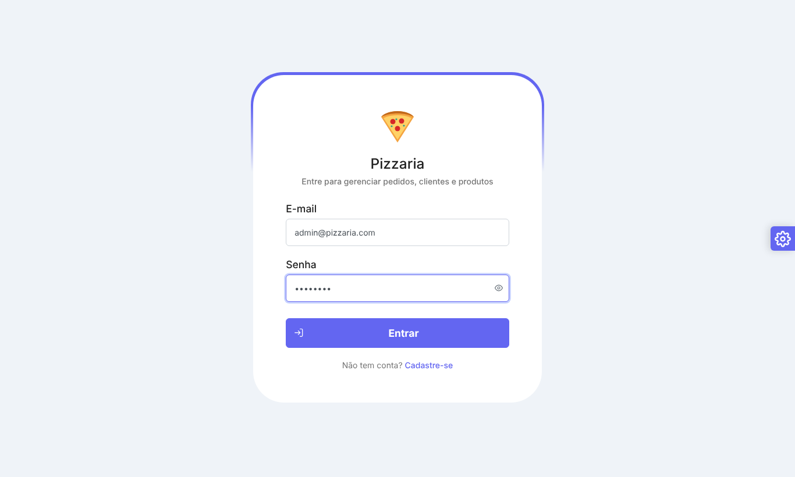

### Dashboard
Totais, faturamento (sem os pedidos cancelados), últimos pedidos e gráfico de pedidos por status.

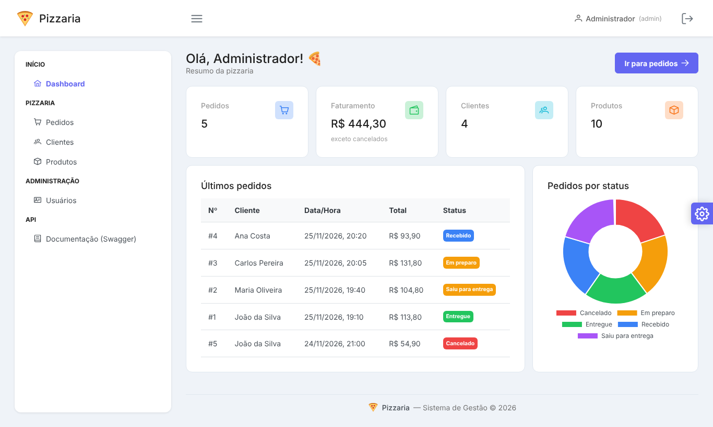

### Pedidos
Lista com troca rápida de status e detalhe dos itens de cada pedido.

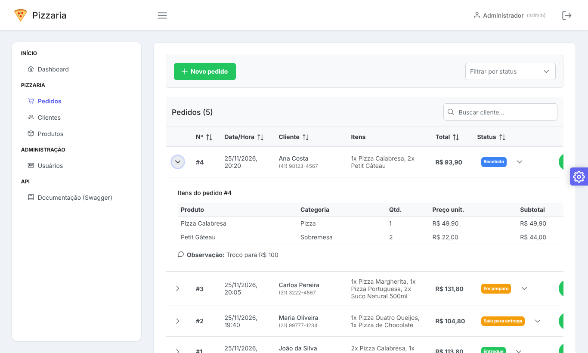

Novo pedido: o total é calculado na hora (e confirmado pela API ao salvar).

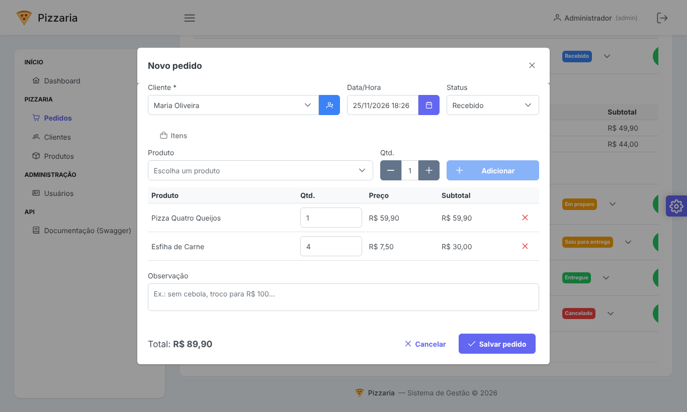

Cadastro rápido de cliente: o atendente digita o nome; se o cliente não existir, cadastra ali mesmo e ele já fica selecionado no pedido.

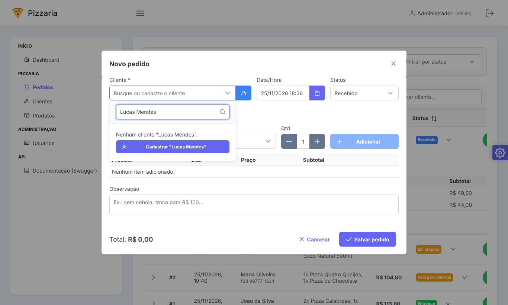
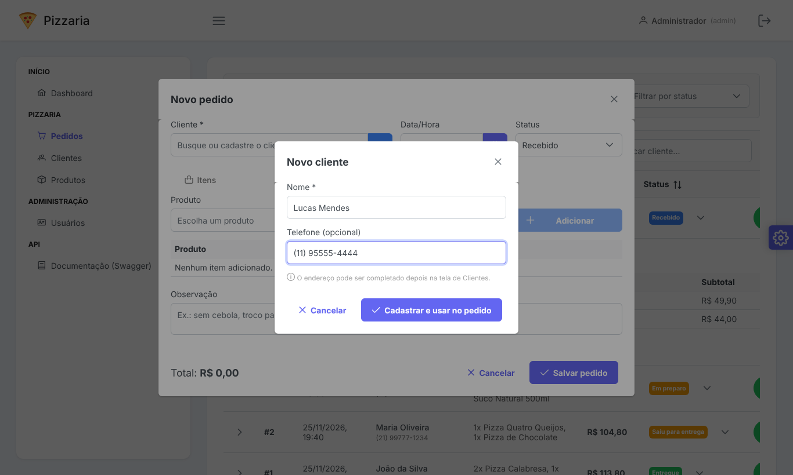

### Clientes
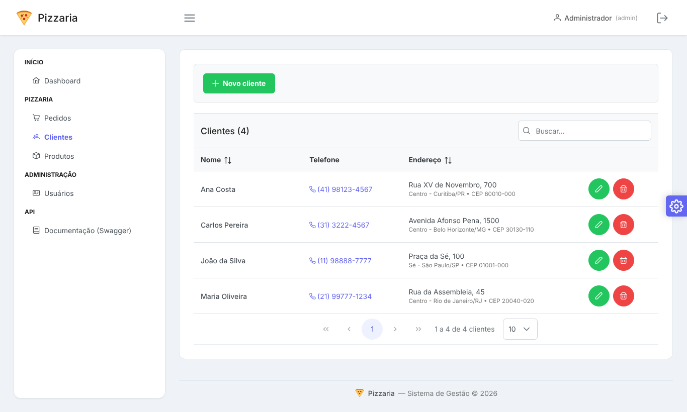

Endereço preenchido pelo **ViaCEP** e estado/município vindos do **IBGE**.

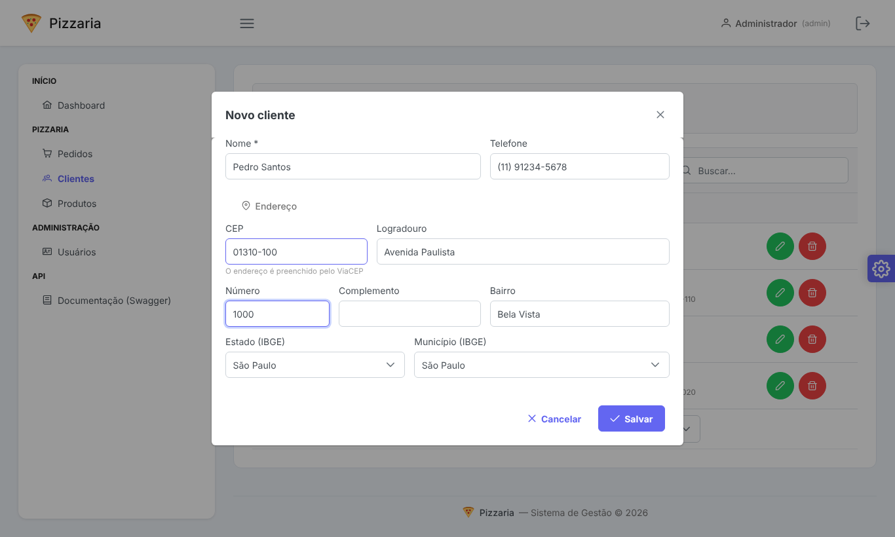

### Produtos e categorias
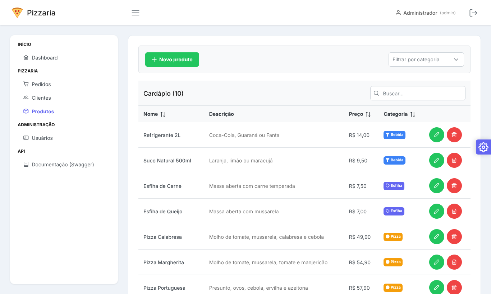

Criação de uma nova categoria sem sair do formulário de produto.

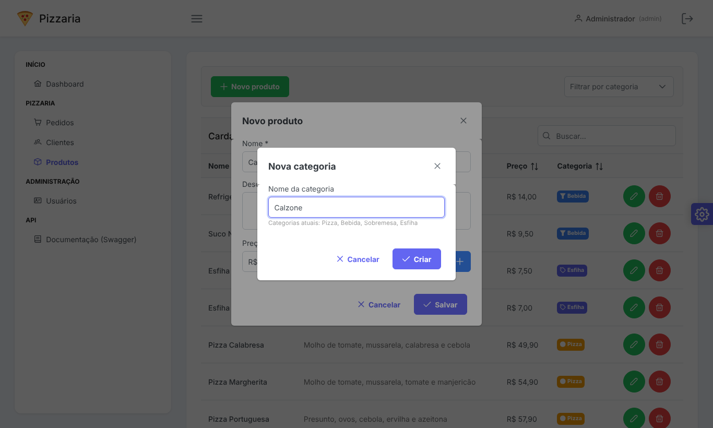

### Usuários (somente admin)
O admin define o perfil de cada conta: administrador, atendente ou cliente.

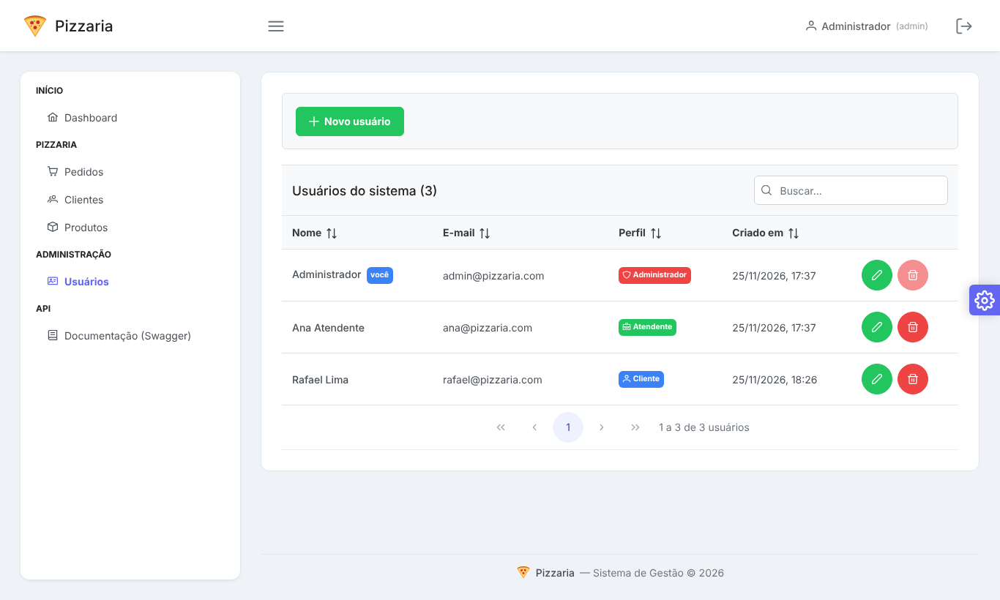

### Cardápio (perfil cliente)
Contas criadas pela tela de cadastro começam como cliente e só veem o cardápio até o admin alterar o perfil.

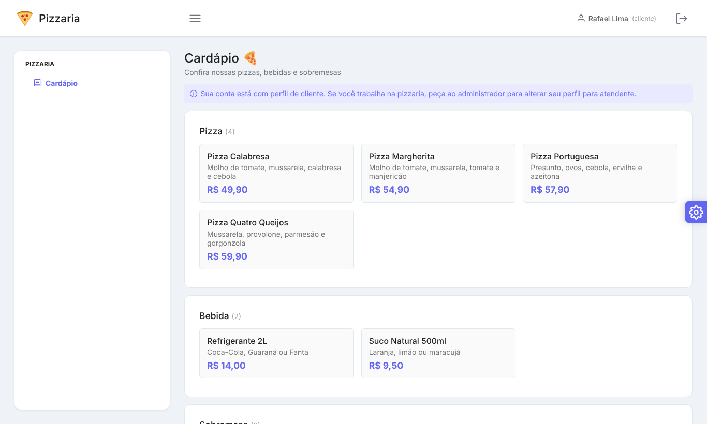

### Documentação Swagger
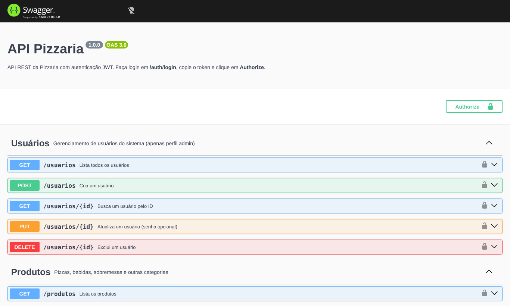

### Celular
No celular as tabelas viram cartões.

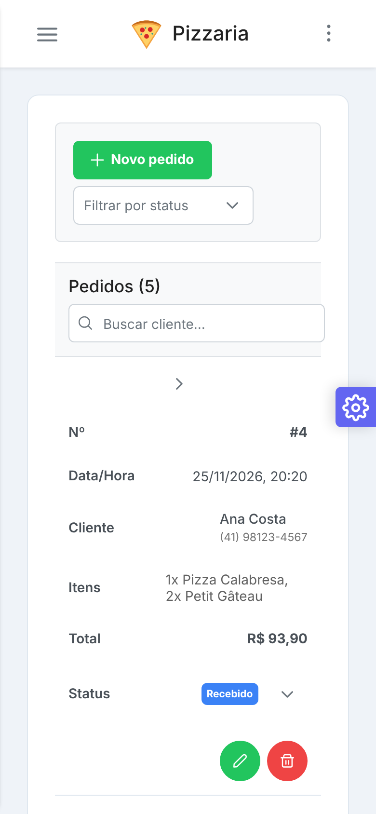

## 🧱 Tecnologias

- **Frontend:** Next.js 13 (App Router), React, TypeScript, PrimeReact, PrimeFlex, **Axios**
- **Backend:** Node.js, Express, SQLite (`sqlite3`), `jsonwebtoken`, `bcryptjs`, `cors`, `swagger-jsdoc`, `swagger-ui-express`
- **APIs externas:** [ViaCEP](https://viacep.com.br) e [IBGE Localidades](https://servicodados.ibge.gov.br/api/docs/localidades)

## 📁 Estrutura

```
.
├── app/                     # Páginas do Next.js
│   ├── (full-page)/auth/    # login, cadastro, acesso negado
│   └── (main)/              # dashboard, clientes, produtos, pedidos, usuarios, cardapio
├── layout/                  # Layout Sakai (menu, topbar) + AuthGuard
├── services/                # Axios (api.ts) e serviços de cada entidade + ViaCEP/IBGE
├── types/pizzaria.d.ts      # Tipos das entidades
├── utils/formatadores.ts    # Moeda, data, telefone, CEP
├── docs/telas/              # Capturas de tela usadas neste README
└── backend/                 # API REST
    ├── server.js            # Sobe o servidor
    ├── app.js               # Express, CORS, Swagger, rotas, erros
    ├── config/swagger.js    # Configuração do Swagger
    ├── db/database.js       # SQLite: tabelas, admin padrão e cardápio inicial
    ├── middleware/auth.js   # Verificação do JWT e do perfil
    ├── models/              # Acesso ao banco
    ├── controllers/         # Regras de negócio e validação
    └── routes/              # Rotas + documentação @swagger
```

## ▶️ Como rodar

Pré-requisito: **Node.js 18+**.

```bash
# 1. Instalar dependências do front e do back
npm run setup

# 2. Configurar a API
cp backend/.env.example backend/.env
# edite backend/.env e troque o JWT_SECRET

# 3. Terminal 1 - API (porta 3001)
npm run api

# 4. Terminal 2 - Frontend (porta 3000)
npm run dev
```

Ou tudo em um terminal (Linux/Mac): `npm run dev:full`.

Acesse **http://localhost:3000** e entre com o admin criado automaticamente:

- **E-mail:** `admin@pizzaria.com`
- **Senha:** `admin123`

(Altere em `backend/.env` antes do primeiro start: `ADMIN_EMAIL` / `ADMIN_SENHA`.)

## 📚 Documentação da API (Swagger)

- Direto na API: http://localhost:3001/api-docs
- Pelo frontend (proxy): http://localhost:3000/backend/api-docs/ — também no menu **API → Documentação (Swagger)**

Para testar rotas protegidas: execute `POST /auth/login`, copie o `token`, clique em **Authorize** e cole o token.

### Endpoints

| Método | Rota | Descrição | Proteção |
| --- | --- | --- | --- |
| POST | `/auth/login` | Login, retorna o JWT | pública |
| POST | `/auth/register` | Cadastro (perfil cliente) | pública |
| GET | `/auth/me` | Usuário logado | JWT |
| GET/POST | `/clientes` | Listar / criar | JWT + admin/atendente |
| GET/PUT/DELETE | `/clientes/:id` | Buscar / atualizar / excluir | JWT + admin/atendente |
| GET | `/produtos`, `/produtos/:id` | Listar (`?categoria=`) / buscar | JWT (qualquer perfil) |
| POST/PUT/DELETE | `/produtos`, `/produtos/:id` | Criar / atualizar / excluir | JWT + admin/atendente |
| GET | `/categorias` | Listar categorias (com total de produtos) | JWT (qualquer perfil) |
| POST/PUT/DELETE | `/categorias`, `/categorias/:id` | Criar / renomear / excluir (se não tiver produtos) | JWT + admin/atendente |
| GET/POST | `/pedidos` | Listar (`?status=`) / criar | JWT + admin/atendente |
| GET/PUT/DELETE | `/pedidos/:id` | Buscar / atualizar / excluir | JWT + admin/atendente |
| PATCH | `/pedidos/:id/status` | Alterar só o status | JWT + admin/atendente |
| GET | `/pedidos/resumo` | Dados do dashboard | JWT + admin/atendente |
| GET/POST | `/usuarios` | Listar / criar | JWT + admin |
| GET/PUT/DELETE | `/usuarios/:id` | Buscar / atualizar / excluir | JWT + admin |

## 🌐 Rodando no GitHub Codespaces

O repositório já vem configurado (pasta `.devcontainer/`). Ao criar o Codespace ele **instala tudo, cria o `backend/.env` com um JWT_SECRET aleatório e sobe a API e o frontend sozinho**.

1. No GitHub, clique em **Code → Codespaces → Create codespace** (na branch que contém o projeto).
2. Espere a instalação terminar (na primeira vez leva alguns minutos).
3. Abra a aba **Ports**, clique com o botão direito na porta **3000** → **Port Visibility → Public**.
4. Copie o endereço da porta 3000 (algo como `https://<nome>-3000.app.github.dev`): esse é o link do projeto online.

O frontend chama a API pelo caminho **`/backend`**, que o `next.config.js` repassa para a porta 3001. Por isso **só a porta 3000 precisa ser pública**. O Swagger fica em `<link-da-porta-3000>/backend/api-docs/`.

> O Codespace desliga sozinho depois de ~30 min sem uso. Antes de apresentar ou de o professor testar, abra o Codespace novamente: a aplicação sobe automaticamente (confira se a porta 3000 continua pública).

Comandos úteis no terminal do Codespace:

```bash
tail -f /tmp/pizzaria-api.log /tmp/pizzaria-front.log   # ver os logs
bash .devcontainer/start.sh                              # reiniciar API + frontend
```

Para expor a API separadamente (opcional): torne a porta 3001 pública, crie `.env.local` na raiz com `NEXT_PUBLIC_API_URL=<url-da-porta-3001>` e coloque a URL do frontend em `CORS_ORIGIN` no `backend/.env`.

## 🔐 CORS

Configurado em `backend/app.js`: aceita as origens listadas em `CORS_ORIGIN` (separadas por vírgula), os métodos `GET, POST, PUT, PATCH, DELETE` e os headers `Content-Type` e `Authorization`. Com `CORS_ORIGIN` vazio, qualquer origem é aceita (útil em ambientes de teste).
